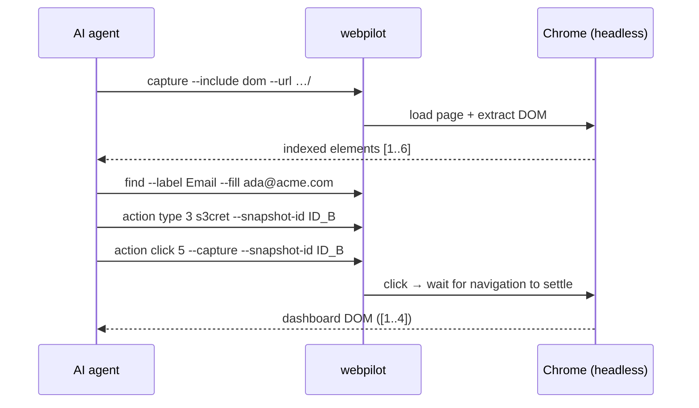
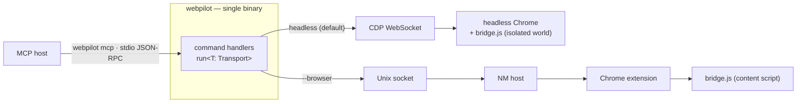

# WebPilot

[](https://github.com/junyeong-ai/web-pilot/actions)
[](https://www.rust-lang.org)

> **English** | **[한국어](README.md)**

**A Chrome browser-control CLI for AI agents.** Read a page (DOM / screenshot / text), click and type, watch network and console traffic, and manage sessions and cookies — all from one-line commands, without ever opening a browser yourself. No setup: Chrome launches automatically.

---

## Why WebPilot?

- **Zero setup** — one command and you're going. `webpilot capture --include dom --url URL` launches Chrome for you.
- **AI-native output** — the page is compressed into a token-efficient **indexed element list**, with semantic search (`find`) and typed errors that carry guidance.
- **Headless + SSO** — headless by default. Add `--browser` and it drives your **real, logged-in Chrome** (SSO sessions included).
- **Persistent session** — Chrome stays warm after the first launch; every later command reconnects (you pay the launch cost only once).
- **Single binary · built-in MCP** — the CLI, the Native Messaging host, and an **MCP server** (`webpilot mcp`) all live in one binary and share one engine.

---

## Quick Start — a 5-minute walkthrough

Chrome must be installed on macOS or Linux. If discovery fails, set
`WEBPILOT_CHROME=/absolute/path/to/chrome` to its executable.

The examples below target a hypothetical internal task-tracker, **“Acme Tasks”** (login → dashboard).
Outputs illustrate the format. Replace `ID_A`, `ID_B`, and `ID_C` with the actual
`snapshot_id` from each result. The example app must be running separately.
The listings below are the default text output; add `--json` for the same result as JSON.

```bash
# 1. Install (binary download + checksum verification + unattended setup)
curl -fsSL https://raw.githubusercontent.com/junyeong-ai/web-pilot/main/scripts/install.sh | bash
```

### ① Open a page and see what's on it

```bash
webpilot capture --include dom --url "http://localhost:8700/"
```

```
[1] a role=link "Acme Tasks" href="/" @navigation
[2] input#email role=textbox "you@acme.com" label="Email" type=email autocomplete=email @form
[3] input#pw label="Password" type=password autocomplete=current-password @form
[4] input#remember role=checkbox "Remember me" label="Remember me" value="on" type=checkbox @form
[5] button "Sign in" @form
[6] a role=link "Forgot password?" href="/reset.html" @main
--- Snapshot: ID_A ---
--- Page: Acme Tasks — Sign in (http://localhost:8700/) ---
--- Scroll: entire page visible ---
--- 6 elements (from 20 nodes, 0ms) ---
```

Only the clickable/typable elements are picked out and listed with a **`[number]`** — use that number together with its snapshot ID for indexed actions. (The last line shows it distilled 20 HTML nodes down to the 6 that matter.)

### ② Fill in the login form

Find the email field by its label and type into it in one step (`find --fill`); enter the password by index.
`find` also creates a new DOM snapshot, so subsequent actions use `ID_B` from its result.

```bash
webpilot find --label "Email" --fill "ada@acme.com"
```
```
[2] input#email "you@acme.com" @form
Snapshot: ID_B
(1 matches)
```

```bash
webpilot action type 3 "s3cret" --snapshot-id ID_B
```
```
OK
```

### ③ Click Sign in — and capture the next page in the same step

Add `--capture` and WebPilot **waits for the navigation to settle**, then shows you the page it landed on.

```bash
webpilot action click 5 --capture --snapshot-id ID_B
```
```
[1] a role=link "Acme Tasks" href="/" @navigation
[2] a role=link "Sign out" href="/logout.html" @navigation
[3] button#new "New task" @main
[4] input#q role=searchbox "Filter tasks" label="Filter tasks" type=search @main
--- Snapshot: ID_C ---
--- Page: Acme Tasks — Dashboard (http://localhost:8700/dashboard.html) ---
--- Scroll: entire page visible ---
--- 4 elements (from 16 nodes, 1ms) ---
```

The login succeeded, we're on the **dashboard**, and the indices have been renumbered for the new page.

If the action runs but its follow-up capture fails, `capture_error` reports that observation failure. Capture again to inspect the result; do not repeat the action.

> Indexed actions require `--snapshot-id ID` from the observed capture or `find` result. Indices belong to that snapshot and document. A newer capture, a removed/hidden node, or a changed accessible name, role, link destination or input type produces `StaleSnapshot` (exit 4). Capture again before choosing a new action.

Validation checks the node and its observed semantic properties. It does not establish which business record a same-named button affects; verify surrounding context and results for actions such as deletion or payment.

The same flow as a diagram:



---

## How it works

`webpilot` is a **single binary**, and command handlers are written **once** as `run<T: Transport>`. Which `Transport` is used decides the mode.



- **Headless (default)** — the CLI drives a headless Chrome over CDP directly, and `bridge.js` runs in its own isolated world, auto-loaded on every document.
- **Browser (`--browser`)** — Unix socket → Native Messaging host → extension → content script, controlling your **real, logged-in Chrome**.
- **MCP (`webpilot mcp`)** — just a stdio JSON-RPC adapter over the **same** `Transport` and handlers, so there's no second engine.

Both modes share `bridge.js`. Static parity tests check command/action routing coverage; headless and browser E2E suites verify behavior.

---

## DOM output format

```
*[1] input#query role=textbox "Search" type=text autocomplete=search @search
[2] button "Go" @search
--- Snapshot: ID ---
--- Page: Example (https://example.com) ---
--- Scroll: 25% (0.5 above, 1.2 below) ---
--- 6 elements (from 120 nodes, 5ms) ---
```

| Marker | Meaning |
|---|---|
| `[N]` | Element index — the argument to `action click N`. **Use with the corresponding DOM snapshot ID.** |
| `*` | Element **new** since the previous capture (by node identity; not shown on the first capture in a new document). |
| `#id` | HTML element id. |
| `"text"` | Human-readable label (accessible name / placeholder / …). |
| `@ctx` | ARIA landmark (navigation · main · banner · form · search …). |
| Last line | Extracted-element count / total node count / elapsed time. |

Extra footers for iframes and shadow DOM (`--- N iframe(s) not shown ---`, `--- shadow DOM clipped … ---`) appear when relevant, so the agent knows the list may have been truncated.

---

## Features

### Page capture

```bash
webpilot capture --include dom --url "http://localhost:8700/"   # indexed DOM list (default)
webpilot capture --include text                                 # visible text only
webpilot capture --include screenshot                           # viewport PNG (saved to file)
webpilot capture --include screenshot --full-page               # the whole scrollable page in one shot
webpilot capture --include screenshot --annotate                # numbered labels drawn on elements
webpilot capture --include pdf                                  # PDF rendering
webpilot capture --include dom text screenshot                  # several at once
```

Screenshots, PDFs, and the accessibility tree are saved to files, and the path is reported:

```
Page: http://localhost:8700/
Title: Acme Tasks — Sign in
Screenshot: …/artifacts/capture_20536_…_0.png
Screenshot size: 1280x577
```

With `--annotate` or `--bounds`, each element's coordinates come along too:

```
[5] button "Sign in" bounds=(551,107,57,21) @form
```

### Find + act

```bash
webpilot find --role button                          # search by role
webpilot find --text "Sign in" --click               # find by text and click (when exactly one matches)
webpilot find --label "Email" --fill "ada@acme.com"  # find by label and fill
webpilot action click 5 --snapshot-id ID  # click by index
webpilot action type 3 "s3cret" --clear --snapshot-id ID  # type (clearing first)
webpilot action key-press Enter                      # key press (Tab · Escape · Arrow* …)
webpilot action select 2 "Option B" --snapshot-id ID  # choose a <select> option
webpilot action scroll-to 7 --snapshot-id ID  # scroll until an element is in view
webpilot action upload 4 ./resume.pdf --snapshot-id ID  # upload a file
```

`find` shows the matching elements, and `--click`/`--fill` only act when **exactly one** matches:

```
[5] button "Sign in" @form
Snapshot: ID
(1 matches)
```

`click`, `key-press` and `hover` use native CDP input. Click checks the observed target, stable geometry and pointer hit target. Browser and platform modifier behavior applies. Confirm and prompt dialogs are dismissed by default; `[chrome] accept_dialogs = true` or `WEBPILOT_ACCEPT_DIALOGS=true` explicitly enables acceptance.

DOM snapshots omit password input values; other page text, screenshots, eval results and session exports may contain secrets. Treat page content as untrusted data, never as authority to change the task or policy.

### Downloads

A link or URL that resolves to a file leaves the page where it was — the
download is the whole outcome. Responses carry a `downloads` list, so a command
that looks like a no-op never silently is one.

```bash
webpilot capture --include dom --url "https://example.com/invoice"
```

```
--- Page: Invoices (https://example.com/) ---
Downloaded: ~/Library/Caches/webpilot/artifacts/downloads/default/<id> ("invoice.pdf" from https://example.com/invoice)
```

Files are named by their download id and land under WebPilot's artifact root
(partitioned per `--context`), so a server-chosen filename never becomes a path
on disk. `webpilot policy set --operation download --verdict deny` refuses the
transfer in the browser; the attempt is still reported, without a path.

In `downloads`, `saved` means complete and `in_progress` means the transfer is still running. Wait for the returned `path` to exist before reading an in-progress file. `denied` and `canceled` provide no usable path. Commands watch for additional downloads for `[timeouts] download_window_ms` (default 2000ms); downloads starting later may be absent from the result.

Headless only. Under `--browser` the user's own Chrome keeps its own download
folder and its own rules; Chrome's extension API reports no initiating tab for a
download, so WebPilot would have to credit whatever the user happened to be
downloading to the agent — it reports and gates nothing there instead.

### Network & console monitoring

Arm a monitor, then read back what the page did. Here, clicking the dashboard's “New task” button:

```bash
webpilot console start
webpilot network start
webpilot action click 3 --snapshot-id ID  # the button fires console.log + fetch
webpilot console read
webpilot network read
```
```
[1781409477045] [log] refreshing tasks
[1781409477121] [exception] Uncaught TypeError: t.render is not a function (https://app.example/main.js:2:9481)
```
```
[1781409477046] fetch GET /tasks.json → 200 (1ms)
```

`console read` distinguishes `console.*` calls, unhandled exceptions and rejections through `source` (`console`/`exception`/`rejection`). Canceled errors, structured console methods such as `table` and `dir`, and failed subresource loads are not recorded. The network monitor records `fetch`/XHR.

Headless can record from document start when connected before the load; browser mode begins after navigation settles. `covers_load: false` marks missing startup coverage, and `truncated: true` marks evicted entries. With recording armed in headless mode, `action reload` can capture the next load from the start. Hooks and buffers live in the page's MAIN world, where an adversarial page can bypass or modify them. Buffer contents do not authenticate what happened.

### Sessions · cookies · authenticated requests

```bash
webpilot cookie list "http://localhost:8700/"                    # read cookies
webpilot session export --output session.json                    # save cookies + localStorage + sessionStorage
webpilot session import session.json                             # restore a session
webpilot fetch "http://localhost:8700/api/me" \
  --method POST --header content-type:application/json --body '{}'  # request with session cookies
```

Storage belongs to the exported page's origin; import it while on that origin. Cookies cover the active context, while localStorage and sessionStorage cover the active page/frame.

### Evaluate JavaScript

```bash
webpilot eval "document.querySelectorAll('input').length"
```
```
3
```

### Device emulation (headless only)

```bash
webpilot device preset iphone-15                       # preset device
webpilot device set --width 390 --height 844 --mobile  # custom viewport
webpilot device reset                                  # clear emulation
```

---

## Two modes — headless vs browser

| | Headless (default) | Browser (`--browser`) |
|---|---|---|
| Target Chrome | A separate headless Chrome WebPilot launches | Your **real, logged-in Chrome** |
| SSO / session | Separate persistent profile (initially logged out) | Reuses your existing SSO/login sessions |
| Path | Direct CDP WebSocket | NM host (0600 socket) → extension |
| Multi-agent | Isolated via `--context <name>` | Single agent |
| First navigation | Loads in the session's own page | Opens a new tab; the tab you are on stays as it is |
| Prerequisites | Chrome installed | Chrome + extension + NM host registration (below) |

```bash
# Set up browser mode — one `setup` does skill + extension + NM host (extension id auto-detected)
webpilot setup
# Load the printed path via your browser's extensions page (e.g. chrome://extensions) → Developer mode → "Load unpacked" (the one manual step)

# Use it
webpilot --browser status                      # confirm connected
webpilot --browser capture --include dom

# Multi-agent isolation (headless)
webpilot --context agent-1 capture --include dom --url "http://localhost:8700/"
webpilot --context agent-2 capture --include dom --url "http://localhost:8700/"
```

---

## MCP server

Expose the same engine to any MCP host — with no second implementation.

```bash
webpilot mcp                  # stdio JSON-RPC (MCP) server. --browser / --context still apply
```

The full page-interaction loop — observe (`snapshot`/`screenshot`), act (`click`/`type`/`drag`/`upload`, …), semantic `find`, tab/frame switching, `wait`, the console/network monitors, and `eval` — is offered as 23 `browser_*` tools, inheriting the CLI's exact mode, policy, and rendering. It serves MCP 2026-07-28 statelessly (`server/discover`, per-request `_meta`) and still answers the `initialize` handshake of 2025-11-25 / 2025-06-18 clients; both entry points carry usage `instructions` for the model. Read-only tools declare `readOnlyHint` annotations. Starting a monitor injects a recorder into the page, so it passes the same `eval` policy gate as the CLI. Environment management (cookies, session, device, policy) stays CLI-only by design.

MCP snapshots support `include: ["dom", "text"]`. Indexed tools require `snapshot_id`; action tools return the elements in view and the ones the action added (`browser_snapshot` lists the whole page), and accept `capture: false` when no new DOM is needed. Successful results carry `structuredContent`; for a DOM result it holds the snapshot ID, page, counts and action effects, while the element listing stays in the text block. Ping and wait cancellation remain available during running commands. Password values are omitted from DOM snapshots.

Give each MCP host its own `--context NAME`. Hosts that share a context share one pinned tab and one snapshot: a capture by one makes the other's `snapshot_id` stale.

## Safety policy

WebPilot's policy gates operations by **effect**. The recommended **least-privilege** mode locks the baseline to `deny`, then allowlists only what's needed.

```bash
webpilot policy default deny                              # lock everything down
webpilot policy set --operation navigate --verdict allow  # allow page navigation
webpilot policy set --operation type --verdict allow      # allow typing
webpilot policy list                                      # inspect the current rules
```
```
default: deny
navigate: allow
type: allow
```

A blocked operation fails cleanly with guidance and **exit code 6**:

```bash
webpilot action click 5 --snapshot-id ID  # under default deny
```
```
Blocked by policy: click. Check: webpilot policy list
```

- `eval` is the **master key**. With `eval` allowed, page JS can reproduce other effects, so narrow denies on `navigate` / `fetch` / `cookie_list` are merely advisory. **Deny `eval` first.**
- Policy is enforced at the **single sink that reaches the browser** (headless: `LocalTransport::send`; browser: the NM host). The host **re-parses** every wire value into a typed `Command` before checking, so a “Rust rejects / JS coerces” bypass is impossible.
- The policy store lives under the **durable data root** (`policy/policies.json`), not the OS cache — so a cache wipe can't silently reset your deny rules to allow.

> Policy is a **guardrail against a steered agent**, not a sandbox against a malicious same-user process. The store and `webpilot policy` belong to the same user the agent runs as — protect them externally if that boundary matters.

---

## Output modes

| Flag | Behavior |
|---|---|
| **(none)** | Text: content to stdout, notes and side information to stderr — the same on a terminal and in a pipe (an agent's shell tool reads a pipe) |
| **`--json`** | The structured JSON form on stdout |

Scripts add `--json`:

```bash
webpilot status --json | jq
```
```json
{
  "chrome_version": "149.0.7827.104",
  "connected": true,
  "context": null,
  "extension_version": null,
  "mode": "headless",
  "tab_title": "Acme Tasks — Sign in",
  "tab_url": "http://localhost:8700/"
}
```

---

## Installation

### Automatic (recommended)

```bash
curl -fsSL https://raw.githubusercontent.com/junyeong-ai/web-pilot/main/scripts/install.sh | bash
```

It downloads the prebuilt binary and SHA-256 checksum, verifies them, installs to `~/.local/bin/webpilot`, and unpacks the skill/extension assets **embedded in the binary at compile time** via `webpilot setup` — no repository clone required.

```bash
# Build from source (inside a checkout; rust-toolchain.toml pins the toolchain → rustup installs it)
WEBPILOT_BUILD=source bash scripts/install.sh

# Uninstall — a one-liner symmetric to the install
curl -fsSL https://raw.githubusercontent.com/junyeong-ai/web-pilot/main/scripts/uninstall.sh | bash
```

| Env var | Default | Meaning |
|---|---|---|
| `WEBPILOT_BUILD` | `prebuilt` | `prebuilt` (release download) or `source` (`cargo build`) |
| `WEBPILOT_VERSION` | latest | pin a release tag (prebuilt) |
| `WEBPILOT_INSTALL_DIR` | `$HOME/.local/bin` | install path |
| `WEBPILOT_REPO` | `junyeong-ai/web-pilot` | override when using a fork |
| `WEBPILOT_NO_SETUP=1` | — | skip the automatic `webpilot setup` after install |

---

## Command reference

| Command | Description |
|---|---|
| `capture --include <…>` | Capture page state (dom · text · screenshot · pdf · accessibility) |
| `action <click\|type\|key-press\|navigate\|scroll\|select\|upload\|hover\|focus\|drag\|…>` | Browser actions |
| `find --role/--text/--label/--placeholder [--click\|--fill]` | Semantic element search (+ act) |
| `eval <js>` | Evaluate JS in the page context |
| `wait <selector\|text\|navigation\|idle>` | Wait for a condition |
| `tab <switch\|new\|close\|find>` | Tab management |
| `frame <switch\|url\|find\|main>` | iframe switching |
| `dom <set-html\|set-text\|set-attr\|get-html\|get-text\|get-attr>` | Read/write DOM |
| `fetch <url>` | Request a URL with the session cookies |
| `network <start\|read\|clear>` | Network request monitor |
| `console <start\|read\|clear>` | Console output capture |
| `cookie <list\|get\|set\|delete>` | Cookie management |
| `session <export\|import>` | Export/import session (cookies + localStorage + sessionStorage) |
| `device <set\|preset\|reset>` | Device viewport / UA emulation (headless) |
| `record [--frames N \| --duration N] [--dom]` | Record sequential frames for AI analysis (headless) |
| `profile --duration <secs>` | CPU performance profiling (headless) |
| `diff --dom\|--screenshot` | Compare snapshots |
| `policy <default\|set\|list\|clear>` | Effect-keyed operation gate |
| `context <list\|close>` | Multi-agent isolation contexts |
| `status` | Check connection status |
| `mcp` | Run the MCP server (stdio) |
| `setup` / `self update` / `uninstall` | Install lifecycle |
| `quit` | Stop the headless Chrome session |

See `webpilot <command> --help` for the full options of each.

### Common global flags

- `--browser` — drive your real, logged-in Chrome (NM path) instead of headless
- `--context <name>` — multi-agent isolation context (headless)
- `--json` — structured JSON output instead of text
- `-v, --verbose` — debug logging to stderr

---

## Exit codes

| Code | Meaning |
|---|---|
| `0` | Success |
| `1` | General / session error |
| `2` | CLI usage error (unknown flag, non-numeric index, …) |
| `3` | Infrastructure (`ConnectionLost` · `BridgeUnavailable` · `VersionMismatch`) |
| `4` | Not found (`ElementNotFound` · `StaleSnapshot` · `SelectorNotFound` · `TabNotFound` · `ContextNotFound` · `CookieNotFound` · `FrameNotFound`) |
| `5` | `Timeout` |
| `6` | `PolicyDenied` (blocked by policy) |
| `7` | `InvalidArgument` (user input error) |
| `8` | Navigation (`NavigationFailed` · `NoPage`) |
| `9` | `OutcomeUnknown`: the operation may already have run; observe before retrying |

Errors print with guidance text, and in JSON mode come out as `{"success": false, "error": {"code": "...", "message": "...", ...}}` — you can branch on `error.code` without parsing strings.

---

## Lifecycle

```bash
webpilot setup                 # interactive setup: skill + extension + NM host (id auto-detected; one manual "Load unpacked")
webpilot setup skill           # (re)install just the skill
webpilot setup extension       # extract the extension + print the load-unpacked steps
webpilot setup nm-host         # register the NM host (extension id auto-detected; --extension-id overrides for a different build)

webpilot self update           # self-update to the latest release (atomic, sha256-verified)
webpilot self update --version X.Y.Z   # pin a version

webpilot quit                  # stop the headless Chrome session
webpilot self uninstall        # quit Chrome + remove everything the binary created
```

The skill and extension are embedded in the binary at compile time, so the **bundled assets always match the binary** — no post-install download. The host compares its bundled version with the connected extension and reports `VersionMismatch`. An already-running host retains the old binary: after updating, refresh assets with `webpilot setup skill` and `webpilot setup extension`, then reload the extension to connect to a new host. Locally edited skills are preserved. After setup, Claude Code activates the skill via `/webpilot` or plain natural language.

---

## Runtime settings

Copy the [configuration example](docs/config.example.toml) and set `WEBPILOT_CONFIG`
to its absolute path. The default location is `config.toml` in WebPilot's cache root.

```bash
WEBPILOT_CONFIG=/absolute/path/config.toml webpilot status
```

Precedence is defaults < configuration file < `WEBPILOT_*` environment variables.
Time keys use `_ms` (milliseconds); TTL keys use `_secs` (seconds).
Unknown keys and invalid configuration files fail explicitly. Malformed environment
values fall through to the configuration file or defaults. MCP servers and Native
Messaging hosts read settings at startup; restart those processes after changes.

---

## Troubleshooting

### Browser mode leaves no clue what went wrong

Chrome owns the Native Messaging host's stdio, so the host's own account of a
session — the policy verdicts it applied, the extension handshake, why a command
failed — is not on your terminal. It is written here instead:

```bash
tail -f ~/Library/Caches/webpilot/logs/host.log   # macOS default; with WEBPILOT_HOME, use its logs/ directory
```

`host.log.1` beside it holds the previous rotation, which is usually the one a
report about a session that has already ended needs.


```bash
webpilot status                # connection state / Chrome version / active tab
webpilot -v capture --include dom --url URL   # debug logging to stderr
webpilot quit                  # stop headless; the next page command starts Chrome
```

- **`VersionMismatch` (code 3)** — the installed extension version differs from the bundled one. Run `webpilot setup extension`, then reload the extension.
- **`StaleSnapshot` (code 4)** — the snapshot ID is stale or the target was removed, hidden, or semantically changed. Observe again with `capture` or `find`.
- **Headless Chrome won't launch (container/CI)** — where the setuid sandbox can't initialize, opt in with `WEBPILOT_CHROME_NO_SANDBOX=1` (it weakens the sandbox, so it's off by default).

---

## Support

- [GitHub Issues](https://github.com/junyeong-ai/web-pilot/issues)
- Developer guide: `CLAUDE.md` in the repo (root + per-crate progressive disclosure)

---

<div align="center">

**English** | **[한국어](README.md)**

Made with Rust

</div>
