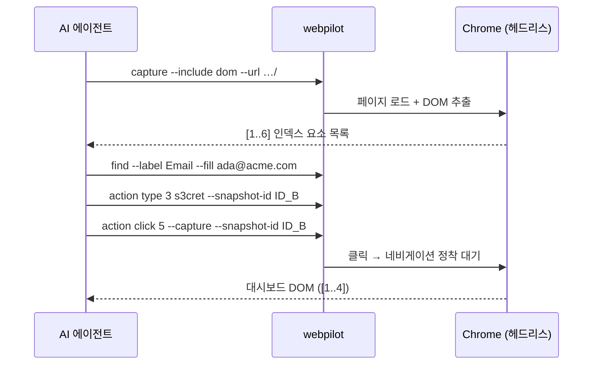
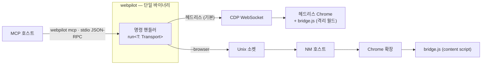

# WebPilot

[](https://github.com/junyeong-ai/web-pilot/actions)
[](https://www.rust-lang.org)

> **[English](README.en.md)** | **한국어**

**AI 에이전트를 위한 Chrome 브라우저 제어 CLI.** 페이지를 읽고(DOM·스크린샷·텍스트), 클릭·입력하고, 네트워크·콘솔을 관찰하고, 세션·쿠키를 다루는 일을 브라우저를 직접 띄우지 않고 한 줄 명령으로 수행합니다. 별도 설정 없이 Chrome이 자동으로 뜹니다.

---

## 왜 WebPilot인가?

- **설정 제로** — 첫 명령 한 줄이면 끝. `webpilot capture --include dom --url URL` 하면 Chrome이 알아서 뜹니다.
- **AI 친화적 출력** — 페이지를 토큰 효율적인 **인덱스 요소 목록**으로 압축해서 보여주고, 의미 기반 검색(`find`)과 가이드가 담긴 타입 에러를 제공합니다.
- **헤드리스 + SSO** — 기본은 헤드리스. `--browser`를 붙이면 로그인된 **실제 Chrome**(SSO 세션 포함)을 그대로 제어합니다.
- **세션 유지** — Chrome은 한 번 떠서 계속 살아 있고, 이후 명령은 매번 재접속합니다(기동 비용은 처음 한 번만).
- **단일 바이너리 · MCP 내장** — CLI / Native Messaging 호스트 / **MCP 서버**(`webpilot mcp`)가 하나의 바이너리에 들어 있고, 셋 다 같은 엔진을 공유합니다.

---

## 빠른 시작 — 5분 따라하기

macOS 또는 Linux에 Chrome이 설치되어 있어야 합니다. 자동 탐지가 안 되면
`WEBPILOT_CHROME=/absolute/path/to/chrome`으로 실행 파일을 지정하세요.

아래 예시는 가상의 사내 할 일 관리 앱 **“Acme Tasks”**(로그인 → 대시보드)를 대상으로 합니다.
출력은 형식을 설명하는 예시입니다. `ID_A`·`ID_B`·`ID_C`는 실제 출력의 `snapshot_id`로 바꾸세요.
예제 앱은 별도로 실행되어 있어야 합니다. 아래 목록은 기본 텍스트 출력이며, `--json`을 붙이면 같은 결과를 JSON으로 받습니다.

```bash
# 1. 설치 (바이너리 다운로드 + 체크섬 검증 + 자동 setup)
curl -fsSL https://raw.githubusercontent.com/junyeong-ai/web-pilot/main/scripts/install.sh | bash
```

### ① 페이지 열고 무엇이 있는지 보기

```bash
webpilot capture --include dom --url "http://localhost:8700/"
```

```
[1] a role=link "Acme Tasks" href="/" @navigation
[2] input#email role=textbox "you@acme.com" label="Email" type=email autocomplete=email @form
[3] input#pw label="Password" type=password autocomplete=current-password @form
[4] input#remember role=checkbox "Remember me" label="Remember me" value="on" type=checkbox @form
[5] button "Sign in" @form
[6] a role=link "Forgot password?" href="/reset.html" @main
--- Snapshot: ID_A ---
--- Page: Acme Tasks — Sign in (http://localhost:8700/) ---
--- Scroll: entire page visible ---
--- 6 elements (from 20 nodes, 0ms) ---
```

페이지의 클릭·입력 가능한 요소만 골라 **`[번호]`** 가 붙은 목록으로 보여줍니다. 이 번호와 스냅샷 ID를 함께 사용해 인덱스 동작의 대상을 지정합니다. (HTML 노드 20개 중 의미 있는 6개만 추렸다는 점도 마지막 줄에서 알 수 있습니다.)

### ② 로그인 폼 채우기

라벨로 이메일 칸을 찾아 바로 입력하고(`find --fill`), 비밀번호는 인덱스로 입력합니다.
`find`도 새 DOM 스냅샷을 만들므로 이후에는 그 결과의 `ID_B`를 사용합니다.

```bash
webpilot find --label "Email" --fill "ada@acme.com"
```
```
[2] input#email "you@acme.com" @form
Snapshot: ID_B
(1 matches)
```

```bash
webpilot action type 3 "s3cret" --snapshot-id ID_B
```
```
OK
```

### ③ 로그인 버튼 클릭 — 그리고 다음 페이지를 바로 캡처

`--capture`를 붙이면 클릭으로 일어난 **네비게이션이 정착할 때까지 기다렸다가** 도착한 페이지를 곧바로 보여줍니다.

```bash
webpilot action click 5 --capture --snapshot-id ID_B
```
```
[1] a role=link "Acme Tasks" href="/" @navigation
[2] a role=link "Sign out" href="/logout.html" @navigation
[3] button#new "New task" @main
[4] input#q role=searchbox "Filter tasks" label="Filter tasks" type=search @main
--- Snapshot: ID_C ---
--- Page: Acme Tasks — Dashboard (http://localhost:8700/dashboard.html) ---
--- Scroll: entire page visible ---
--- 4 elements (from 16 nodes, 1ms) ---
```

로그인에 성공해 **대시보드**로 넘어왔고, 인덱스가 새 페이지 기준으로 다시 매겨졌습니다.

액션은 실행됐지만 후속 캡처만 실패하면 `Capture failed (the action itself succeeded)`가 출력됩니다(JSON에서는 `capture_error`). 이때 액션을 반복하지 말고 `capture`로 결과를 다시 관찰하세요.

> 인덱스 액션에는 관찰한 캡처 또는 `find` 결과의 `--snapshot-id ID`가 필요합니다. 다른 캡처·문서의 인덱스, 제거·숨김 처리된 요소, 접근성 이름·역할·링크 목적지·입력 타입이 바뀐 요소는 `StaleSnapshot`(종료 코드 4)으로 거절됩니다. 다시 캡처한 상태에서 다음 액션을 선택하세요.

검사는 노드와 관찰한 의미 정보의 일치를 확인합니다. 같은 이름의 버튼이 어떤 업무 항목을 처리하는지까지 보장하지 않으므로, 삭제·결제 같은 작업은 주변 문맥과 결과도 확인하세요.

이 흐름을 그림으로 보면:



---

## 작동 방식

`webpilot`는 **단일 바이너리**이며, 명령 핸들러는 `run<T: Transport>`로 **한 번만** 작성됩니다. 어느 `Transport`를 쓰느냐가 모드를 결정합니다.



- **헤드리스(기본)** — CLI가 CDP로 헤드리스 Chrome을 직접 몰고, `bridge.js`는 페이지마다 자동 로드되는 자기만의 격리 월드에서 돕니다.
- **브라우저(`--browser`)** — Unix 소켓 → Native Messaging 호스트 → 확장 → content script 경로로 **로그인된 실제 Chrome**을 제어합니다.
- **MCP(`webpilot mcp`)** — 위와 **똑같은** `Transport`·핸들러 위에 stdio JSON-RPC 어댑터만 얹은 것이라, 별도 엔진이 없습니다.

두 모드는 같은 `bridge.js`를 공유합니다. 정적 패리티 테스트는 명령·액션의 라우팅 누락을 검사하며, 실제 동작은 헤드리스·브라우저 E2E 스위트로 검증합니다.

---

## DOM 출력 형식

```
*[1] input#query role=textbox "Search" type=text autocomplete=search @search
[2] button "Go" @search
--- Snapshot: ID ---
--- Page: Example (https://example.com) ---
--- Scroll: 25% (0.5 above, 1.2 below) ---
--- 2 elements (from 120 nodes, 5ms) ---
```

| 표기 | 의미 |
|---|---|
| `[N]` | 요소 인덱스 — `action click N`의 인자. **해당 DOM 스냅샷의 ID와 함께 사용**합니다. |
| `*` | 직전 capture 이후 **새로 생긴** 요소 (노드 식별자 기준; 새 문서의 첫 capture에서는 표시하지 않음). |
| `#id` | HTML 요소 id. |
| `"텍스트"` | 접근성 이름 / 플레이스홀더 등 사람이 읽는 라벨. |
| `@ctx` | ARIA 랜드마크 (navigation · main · banner · form · search …). |
| 마지막 줄 | 추출 요소 수 / 전체 노드 수 / 소요 시간. |

필요할 때 추가 푸터(`N iframe(s) not shown`, `shadow DOM clipped`, `page text clipped`, `index shortened`)가 표시되어, 목록이 완전하지 않다는 것을 에이전트가 알 수 있습니다. 액션의 `--capture`는 화면 안 요소와 그 액션이 추가한 요소를 나열하고, 나머지는 `--- N offscreen element(s) not listed ---`로 개수만 알립니다(인덱스는 그대로 유효합니다).

---

## 주요 기능

### 페이지 캡처

```bash
webpilot capture --include dom --url "http://localhost:8700/"   # 인덱스 DOM 목록 (기본)
webpilot capture --include text                                 # 보이는 텍스트만
webpilot capture --include screenshot                           # 뷰포트 PNG (파일로 저장)
webpilot capture --include screenshot --full-page               # 스크롤 전체를 한 장에
webpilot capture --include screenshot --annotate                # 요소에 번호 라벨을 그려서 캡처
webpilot capture --include pdf                                  # PDF 렌더링
webpilot capture --include dom text screenshot                  # 한 번에 여러 개
```

스크린샷·PDF·접근성 트리는 파일로 저장되고, 경로를 알려줍니다:

```
Page: http://localhost:8700/
Title: Acme Tasks — Sign in
Screenshot: …/artifacts/capture_20536_…_0.png
Screenshot size: 1280x577
```

`--annotate`나 `--bounds`를 쓰면 각 요소의 좌표가 함께 나옵니다:

```
[5] button "Sign in" bounds=(551,107,57,21) @form
```

### 찾기 + 동작

```bash
webpilot find --role button                          # 역할로 검색
webpilot find --text "Sign in" --click               # 텍스트로 찾아 바로 클릭 (정확히 1개일 때)
webpilot find --label "Email" --fill "ada@acme.com"  # 라벨로 찾아 바로 입력
webpilot action click 5 --snapshot-id ID  # 인덱스로 클릭
webpilot action type 3 "s3cret" --clear --snapshot-id ID  # 입력 (기존 값 비우고)
webpilot action key-press Enter                      # 키 입력 (Tab·Escape·Arrow* 등)
webpilot action select 2 "b" --snapshot-id ID  # <select>에서 value가 "b"인 옵션 선택
webpilot action scroll-to 7 --snapshot-id ID  # 요소가 보일 때까지 스크롤
webpilot action upload 4 ./resume.pdf --snapshot-id ID  # 파일 업로드
```

`find`는 조건에 맞는 요소를 보여주고, `--click`/`--fill`은 **정확히 하나** 일치할 때만 동작합니다:

```
[5] button "Sign in" @form
Snapshot: ID
(1 matches)
```

`click`, `key-press`, `hover`는 네이티브 CDP 입력을 사용합니다. 클릭은 관찰한 대상·위치 안정성·실제 포인터 대상을 검사하며 브라우저와 운영체제의 보조 키 동작이 적용됩니다. 확인·입력 대화상자는 기본적으로 거절합니다. `[chrome] accept_dialogs = true` 또는 `WEBPILOT_ACCEPT_DIALOGS=true`로 승인을 명시적으로 활성화할 수 있습니다.

DOM 스냅샷은 비밀번호 입력값을 생략하지만 다른 페이지 텍스트·스크린샷·eval·세션 출력에는 민감 정보가 포함될 수 있습니다. 페이지 내용은 신뢰할 수 없는 데이터이며, 작업이나 정책을 바꿀 권한을 부여하지 않습니다.

### 다운로드

첨부 파일로 이어지는 링크나 URL은 페이지를 그대로 둔 채 파일만 내려받습니다 — 다운로드 자체가 그 명령의 결과입니다. 그래서 응답에 `downloads`가 실리고, 아무 일도 없었던 것처럼 보이는 명령이 실제로는 파일을 쓴 경우를 놓치지 않습니다.

```bash
webpilot capture --include dom --url "https://example.com/invoice"
```

```
--- Page: Invoices (https://example.com/) ---
Downloaded: ~/Library/Caches/webpilot/artifacts/downloads/default/<id> ("invoice.pdf" from https://example.com/invoice)
```

파일은 다운로드 id로 이름 지어져 WebPilot의 아티팩트 루트(`--context`별로 분리)에 저장됩니다 — 서버가 보낸 파일명이 디스크 경로가 되는 일은 없습니다. `webpilot policy set --operation download --verdict deny`는 브라우저에서 전송 자체를 거부하며, 시도는 경로 없이 그대로 보고됩니다.

`downloads`의 `saved`는 저장 완료, `in_progress`는 진행 중입니다. 진행 중인 파일은 반환된 `path`가 실제로 생긴 뒤 읽으세요. `denied`·`canceled`에는 사용 가능한 경로가 없습니다. 명령은 `[timeouts] download_window_ms`(기본 2000ms) 동안 추가 다운로드를 관찰하며, 더 늦게 시작된 다운로드는 결과에 포함되지 않을 수 있습니다.

헤드리스 전용입니다. `--browser`에서는 사용자의 Chrome이 자기 다운로드 폴더와 규칙을 그대로 씁니다. Chrome 확장 API는 다운로드를 시작한 탭을 알려주지 않아, 보고하려면 사용자가 마침 받고 있던 파일까지 에이전트 명령 탓으로 돌리게 됩니다 — 그래서 브라우저 모드에서는 보고도 게이트도 하지 않습니다.

### 네트워크 · 콘솔 관찰

모니터를 켜둔 뒤(arm) 페이지가 일으킨 활동을 읽습니다. 아래는 대시보드에서 “New task” 버튼을 눌렀을 때:

```bash
webpilot console start
webpilot network start
webpilot action click 3 --snapshot-id ID  # 버튼이 console.log + fetch 를 일으킴
webpilot console read
webpilot network read
```
```
[1781409477045] [log] refreshing tasks
[1781409477121] [exception] Uncaught TypeError: t.render is not a function (https://app.example/main.js:2:9481)
```
```
[1781409477046] fetch GET /tasks.json → 200 (1ms)
```

`console read`는 `console.*` 호출, 처리되지 않은 예외와 rejection을 `source`(`console`/`exception`/`rejection`)로 구분합니다. 취소된 오류, 구조화된 콘솔 메서드(`table`·`dir` 등), 서브리소스 로드 실패는 기록하지 않습니다. 네트워크 모니터는 `fetch`/XHR을 기록합니다.

헤드리스는 로드 전에 연결되어 있을 때 문서 시작부터 기록할 수 있고, 브라우저 모드는 내비게이션 정착 후 기록을 시작합니다. `covers_load: false`는 시작 시점 출력이 누락됐음을, `truncated: true`는 이전 항목이 버퍼에서 제거됐음을 뜻합니다. 기록이 켜진 헤드리스에서 `action reload`하면 다음 로드를 처음부터 관찰할 수 있습니다. 훅과 버퍼는 페이지의 MAIN 월드에 있으므로 적대적 페이지가 우회하거나 조작할 수 있습니다. 버퍼 내용은 실제 발생 여부를 인증하지 않습니다.

### 세션 · 쿠키 · 인증 요청

```bash
webpilot cookie list "http://localhost:8700/"                    # 쿠키 읽기
webpilot session export --output session.json                    # 쿠키 + localStorage + sessionStorage 저장
webpilot session import session.json                             # 세션 복원
webpilot fetch "http://localhost:8700/api/me" \
  --method POST --header content-type:application/json --body '{}'  # 세션 쿠키로 인증 요청
```

저장소 데이터는 내보낸 페이지의 origin에 속하며, 가져오기는 해당 origin에서 수행해야 합니다. 쿠키는 현재 컨텍스트 전체, localStorage·sessionStorage는 고정 탭의 페이지와 프레임 범위입니다.

### 자바스크립트 평가

```bash
webpilot eval "document.querySelectorAll('input').length"
```
```
3
```

### 기기 에뮬레이션 (헤드리스 전용)

```bash
webpilot device preset iphone-15                       # 프리셋 기기
webpilot device set --width 390 --height 844 --mobile  # 커스텀 뷰포트
webpilot device reset                                  # 에뮬레이션 해제
```

---

## 두 가지 모드 — 헤드리스 vs 브라우저

| | 헤드리스 (기본) | 브라우저 (`--browser`) |
|---|---|---|
| 대상 Chrome | WebPilot이 띄우는 별도 헤드리스 Chrome | 당신이 쓰는, **로그인된 실제 Chrome** |
| SSO / 세션 | 별도 영속 프로필(첫 실행은 로그인 없음) | 기존 SSO·로그인 세션 그대로 사용 |
| 경로 | CDP WebSocket 직결 | NM 호스트(0600 소켓) → 확장 |
| 멀티 에이전트 | `--context <이름>`으로 격리(최대 16개, 쓰는 프로세스 없이 `[context] ttl_secs`(기본 1시간)가 지나면 회수) | 단일 에이전트 |
| 작업 탭 | 세션 자체 페이지 | 에이전트 자신의 탭: URL을 열면 새 탭을 엶. 읽기는 보고 있는 탭을 빌리고, 그 뒤에 URL을 열면 그 페이지를 덮지 않고 새 탭을 엶. 그 밖의 명령은 탭이 정해질 때까지 거절 |
| 사전 준비 | Chrome 설치 | Chrome 설치 + 확장 + NM 호스트 등록(아래) |

```bash
# 브라우저 모드 준비 — setup 한 번이 스킬·확장·NM 호스트까지 (확장 ID 자동 탐지)
webpilot setup
# 안내된 경로를 브라우저 확장 페이지(예: chrome://extensions) → 개발자 모드 → "압축해제된 확장 로드" (유일한 수동 단계)

# 사용
webpilot --browser status                      # connected 확인
webpilot --browser capture --include dom

# 멀티 에이전트 격리 (헤드리스)
webpilot --context agent-1 capture --include dom --url "http://localhost:8700/"
webpilot --context agent-2 capture --include dom --url "http://localhost:8700/"
```

---

## MCP 서버

같은 엔진을 어떤 MCP 호스트에든 그대로 노출합니다 — 두 번째 구현이 없습니다.

```bash
webpilot mcp                  # stdio JSON-RPC (MCP) 서버. --browser / --context 도 그대로 적용
```

페이지 상호작용 전반(관찰 `snapshot`/`screenshot`, 액션 `click`/`type`/`drag`/`upload` 등, 시맨틱 검색 `find`, 탭/프레임 전환, `wait`, 콘솔·네트워크 모니터, `eval`)이 23개 `browser_*` 툴로 제공되며, CLI와 동일한 모드·정책·렌더링을 물려받습니다. MCP 2026-07-28을 상태 없이(`server/discover`, 요청별 `_meta`) 제공하면서 2025-11-25 / 2025-06-18 클라이언트의 `initialize` 핸드셰이크에도 응답하며, 두 진입점 모두 모델용 사용 지침(`instructions`)을 함께 보냅니다. 읽기 전용 툴은 `readOnlyHint` 어노테이션을 선언합니다. 모니터를 시작하면 페이지에 기록기를 주입하므로 CLI와 같은 `eval` 정책 게이트를 거칩니다. 환경 관리(쿠키·세션·디바이스·정책)는 의도적으로 CLI 전용입니다.

MCP snapshot은 `include: ["dom", "text"]`를 지원합니다. 인덱스 툴에는 `snapshot_id`가 필요하며, 액션 툴은 화면 안 요소와 그 액션이 추가한 요소를 돌려주고(`browser_snapshot`은 페이지 전체를 나열합니다), `capture: false`로 DOM 반환을 생략할 수 있습니다. 성공 결과도 `structuredContent`로 제공하며(DOM 결과에는 스냅샷 ID, 페이지, 개수, 액션 효과가 담기고 요소 목록은 텍스트 블록에만 있습니다), 실행 중 ping과 대기 취소를 처리합니다. DOM 스냅샷에는 비밀번호 값을 포함하지 않습니다.

헤드리스에서는 MCP 호스트마다 `--context NAME`을 따로 지정하세요(브라우저 모드는 에이전트 하나만 지원합니다). 컨텍스트를 함께 쓰는 호스트들은 고정 탭과 스냅샷도 함께 쓰므로, 한쪽이 캡처하면 다른 쪽의 `snapshot_id`가 무효가 됩니다.

## 안전 정책 (policy)

WebPilot의 정책은 **효과(effect)** 기준으로 동작을 게이트합니다. 기본을 `deny`로 잠근 뒤 필요한 것만 허용(allowlist)하는 **최소 권한** 모드가 권장됩니다.

```bash
webpilot policy default deny                              # 전부 잠금
webpilot policy set --operation navigate --verdict allow  # 페이지 이동 허용
webpilot policy set --operation type --verdict allow      # 입력 허용
webpilot policy list                                      # 현재 규칙 확인
```
```
default: deny
navigate: allow
type: allow
```

차단된 동작은 가이드와 함께 **종료 코드 6**으로 명확히 실패합니다:

```bash
webpilot action click 5 --snapshot-id ID  # default deny 상태
```
```
Blocked by policy: click. Check: webpilot policy list
```

- `eval`은 **마스터 키**입니다. `eval`이 허용되면 페이지 JS로 다른 효과를 재현할 수 있으니, `navigate`·`fetch`·`cookie_list` 같은 좁은 deny는 보조적일 뿐입니다. **`eval`을 먼저 막으세요.**
- 정책은 **프로세스가 브라우저에 닿는 지점**에서 강제됩니다: `LocalTransport::send`(헤드리스), NM 호스트(브라우저), `device`·`context close` 핸들러. 호스트는 모든 와이어 값을 타입 있는 `Command`로 **다시 파싱**한 뒤 검사하므로 “Rust는 거부, JS는 강제 변환” 식 우회가 불가능합니다.
- 정책 저장소는 OS 캐시가 아니라 **영속 데이터 루트**(`policy/policies.json`, `WEBPILOT_HOME`을 지정하면 그 아래)에 있어, 캐시 정리로 deny 규칙이 슬그머니 풀리지 않습니다.

> 정책은 **방향이 틀어진 에이전트에 대한 가드레일**이지, 같은 사용자 권한의 악성 프로세스를 막는 샌드박스가 아닙니다. 저장소와 `webpilot policy`는 에이전트와 같은 사용자 소유입니다 — 그 경계가 중요하다면 외부에서 보호하세요.

---

## 출력 모드

| 플래그 | 동작 |
|---|---|
| **(없음)** | 텍스트. DOM 목록과 값(`eval`·`fetch`·`dom get-*`·`cookie get`)은 stdout으로, 목록·상태·안내·산출물 경로·오류는 stderr로 나갑니다. 터미널과 파이프에서 같습니다(에이전트의 셸 도구는 파이프로 읽습니다) |
| **`--json`** | 결과와 오류를 구조화된 JSON으로 stdout에 |

스크립트에서는 `--json`을 붙입니다:

```bash
webpilot status --json | jq
```
```json
{
  "chrome_version": "149.0.7827.104",
  "connected": true,
  "context": null,
  "extension_version": null,
  "mode": "headless",
  "pin": "own",
  "tab_title": "Acme Tasks — Sign in",
  "tab_url": "http://localhost:8700/"
}
```

---

## 설치

### 자동 설치 (권장)

```bash
curl -fsSL https://raw.githubusercontent.com/junyeong-ai/web-pilot/main/scripts/install.sh | bash
```

릴리스의 사전 빌드 바이너리와 SHA-256 체크섬을 내려받아 검증한 뒤 `~/.local/bin/webpilot`에 설치하고, `webpilot setup`을 실행해 바이너리에 **컴파일 타임에 임베드된** 스킬과 확장을 풀고 NM 호스트를 등록합니다. 기본으로는 묻지 않고 진행하며, 직접 고친 스킬은 유지합니다. 저장소를 clone할 필요가 없습니다.

```bash
# 소스에서 빌드 (체크아웃 안에서; rust-toolchain.toml 이 툴체인을 고정 → rustup 이 설치)
WEBPILOT_BUILD=source bash scripts/install.sh

# 제거 — 설치한 것과 대칭인 한 줄. 지우기 전에 확인을 묻으므로, 터미널이 없는 환경(CI, 에이전트의 셸)에서는 끝에 `-s -- --yes`를 붙입니다
curl -fsSL https://raw.githubusercontent.com/junyeong-ai/web-pilot/main/scripts/uninstall.sh | bash
```

| 환경변수 | 기본값 | 의미 |
|---|---|---|
| `WEBPILOT_BUILD` | `prebuilt` | `prebuilt`(릴리스 다운로드) 또는 `source`(`cargo build`) |
| `WEBPILOT_VERSION` | latest | 릴리스 태그 고정(prebuilt) |
| `WEBPILOT_INSTALL_DIR` | `$HOME/.local/bin` | 설치 경로 |
| `WEBPILOT_REPO` | `junyeong-ai/web-pilot` | 포크 사용 시 override |
| `WEBPILOT_NO_SETUP=1` | — | 설치 후 자동 `webpilot setup` 생략 |

---

## 명령어 참조

| 명령어 | 설명 |
|---|---|
| `capture --include <…>` | 페이지 상태 캡처 (dom · text · screenshot · pdf · accessibility) |
| `action <click\|type\|key-press\|navigate\|scroll\|select\|upload\|hover\|focus\|drag\|…>` | 브라우저 동작 |
| `find --role/--text/--label/--placeholder/--tag [--click\|--fill]` | 의미 기반 요소 검색(+동작) |
| `eval <js>` | 페이지 컨텍스트에서 JS 평가 |
| `wait <selector\|text\|navigation\|idle>` | 조건 대기 |
| `tab [switch\|new\|close\|find]` | 탭 관리(하위 명령 없이 실행하면 탭 목록) |
| `frame [switch\|url\|find\|main]` | iframe 전환(하위 명령 없이 실행하면 프레임 목록) |
| `dom <set-html\|set-text\|set-attr\|get-html\|get-text\|get-attr>` | DOM 읽기/쓰기 |
| `fetch <url>` | 세션 쿠키로 URL 요청 |
| `network <start\|read\|clear>` | 네트워크 요청 모니터 |
| `console <start\|read\|clear>` | 콘솔 출력 캡처 |
| `cookie <list\|get\|set\|delete>` | 쿠키 관리 |
| `session <export\|import>` | 세션(쿠키+localStorage+sessionStorage) 내보내기/가져오기 |
| `device <set\|preset\|reset>` | 기기 뷰포트·UA 에뮬레이션 (헤드리스) |
| `record [--frames N \| --duration N] [--dom]` | 연속 프레임 기록 (AI 분석용, 헤드리스) |
| `profile --duration <초>` | CPU 성능 프로파일링 (헤드리스) |
| `diff --dom\|--screenshot <이전> <이후>` | 저장한 DOM 스냅샷(JSON)이나 스크린샷 비교 |
| `policy <default\|set\|list\|clear>` | 효과 기준 동작 게이트 |
| `context <list\|close>` | 멀티 에이전트 격리 컨텍스트 |
| `status` | 연결 상태 확인 |
| `mcp` | MCP 서버(stdio) 실행 |
| `setup` / `self update` / `self uninstall` | 설치 라이프사이클 |
| `quit` | 헤드리스 Chrome 세션 종료 |

전체 옵션은 `webpilot <command> --help`로 확인하세요.

### 공통 글로벌 플래그

- `--browser` — 헤드리스 대신 로그인된 실제 Chrome(NM 경로) 제어
- `--context <이름>` — 멀티 에이전트 격리 컨텍스트(헤드리스)
- `--json` — 텍스트 대신 구조화된 JSON 출력
- `-v, --verbose` — stderr 디버그 로그

---

## 종료 코드

| 코드 | 의미 |
|---|---|
| `0` | 성공 |
| `1` | 일반 / 세션 오류, 다른 활성 프로세스가 쓰는 컨텍스트(`ContextInUse`) |
| `2` | CLI 사용법 오류 (알 수 없는 플래그, 숫자가 아닌 인덱스 등) |
| `3` | 인프라 (`ConnectionLost` · `BridgeUnavailable` · `VersionMismatch`) |
| `4` | 찾지 못함 (`ElementNotFound` · `StaleSnapshot` · `SelectorNotFound` · `TabNotFound` · `NoPinnedTab` · `ContextNotFound` · `CookieNotFound` · `FrameNotFound`) |
| `5` | `Timeout` |
| `6` | `PolicyDenied` (정책 차단) |
| `7` | `InvalidArgument` (사용자 입력 오류) |
| `8` | 네비게이션 (`NavigationFailed` · `NoPage`) |
| `9` | `OutcomeUnknown`: 이미 실행됐을 수 있으므로 재시도 전에 상태 관찰 필요 |

에러는 가이드 텍스트와 함께 출력되며, JSON 모드에서는 `{"success": false, "error": {"code": "...", "message": "...", ...}}` 구조로 나옵니다 — 문자열 파싱 없이 `error.code`로 분기할 수 있습니다.

---

## 라이프사이클

```bash
webpilot setup                 # 대화형 setup: 스킬 + 확장 + NM 호스트 (확장 ID 자동 탐지; 수동은 "압축해제된 확장 로드" 한 번)
webpilot setup skill           # 스킬만 (재)설치
webpilot setup extension       # 확장 추출 + 로드 안내(압축해제된 확장 로드) 출력
webpilot setup nm-host         # NM 호스트 등록 (확장 ID 자동 탐지; --extension-id 는 다른 빌드용 override)

webpilot self update           # 최신 릴리스로 자가 업데이트 (atomic, sha256 검증)
webpilot self update --version X.Y.Z   # 버전 고정

webpilot quit                  # 헤드리스 Chrome 세션 종료
webpilot self uninstall        # Chrome 종료 + 바이너리가 만든 모든 흔적 제거
```

스킬과 확장은 컴파일 타임에 바이너리에 임베드되어 **번들 자산이 항상 바이너리와 일치**합니다(설치 후 추가 다운로드 없음). 호스트는 연결된 확장과 자신의 번들 버전을 비교해 `VersionMismatch`를 반환합니다. 이미 실행 중인 호스트는 이전 바이너리를 유지합니다. `webpilot self update`는 스킬(로컬 편집은 보존)과 확장 파일을 갱신한 뒤 남은 한 단계, 즉 확장을 리로드해 새 호스트에 연결하라는 안내를 출력합니다. 다른 방법으로 바이너리를 설치했다면 `webpilot setup skill`과 `webpilot setup extension`을 직접 실행하세요. setup 이후 Claude Code에서 `/webpilot` 또는 자연어로 스킬이 활성화됩니다.

---

## 실행 설정

[설정 예제](docs/config.example.toml)를 복사하고 `WEBPILOT_CONFIG`로 경로를 지정하세요.
기본 위치는 WebPilot 캐시 루트의 `config.toml`입니다. 캐시 루트는 비워질 수 있는 위치이고 Linux에서는 `$XDG_RUNTIME_DIR` 아래일 수 있으므로, 오래 둘 설정은 `WEBPILOT_CONFIG`로 지정하세요.

```bash
WEBPILOT_CONFIG=/absolute/path/config.toml webpilot status
```

우선순위는 기본값 < 설정 파일 < `WEBPILOT_*` 환경변수입니다.
시간 키는 `_ms`(밀리초), TTL은 `_secs`(초)를 사용합니다.
알 수 없는 키·잘못된 설정 파일은 오류로 처리합니다. 형식이 잘못된 환경변수는
설정 파일 또는 기본값으로 내려갑니다. MCP 서버와 Native Messaging 호스트는
시작할 때 설정을 읽으므로 변경 후 해당 프로세스를 다시 시작하세요(호스트는
확장을 리로드하면 다시 시작됩니다).

브라우저 모드는 설정과 정책 저장소를 Native Messaging 호스트에서 읽습니다. 이
호스트는 Chrome이 자기 환경으로 실행하므로, 셸에서 지정한 `WEBPILOT_*`
환경변수, `WEBPILOT_CONFIG`, `WEBPILOT_HOME`, `WEBPILOT_DATA_HOME`은 전달되지
않습니다. 브라우저 모드 설정은 기본 위치의 `config.toml`에 두거나, Chrome을
실행하는 환경에 지정하세요. CLI 프로세스도 `[timeouts] ipc_response_ms`와
`[capture] max_elements`는 직접 읽고, 호스트 소켓은 자기 환경으로 찾습니다. 그래서
셸에만 지정한 `WEBPILOT_HOME`이나 `WEBPILOT_SOCKET`은 CLI를 호스트가 열지 않은
소켓으로 보냅니다.

---

## 문제 해결

### 브라우저 모드에서 뭐가 잘못됐는지 안 보일 때

Native Messaging 호스트의 stdio는 Chrome이 가져갑니다. 그래서 호스트가 본 것 — 적용한 정책 판정, 확장과의 핸드셰이크, 명령이 실패한 이유 — 은 터미널에 나오지 않습니다. 대신 여기에 기록됩니다:

```bash
tail -f ~/Library/Caches/webpilot/logs/host.log   # macOS 기본값. Linux는 $XDG_RUNTIME_DIR/webpilot/logs/ (없으면 $XDG_CACHE_HOME/webpilot/logs/ 또는 ~/.cache/webpilot/logs/). Chrome 환경에 WEBPILOT_HOME을 지정했다면 그 아래 logs/
```

옆의 `host.log.1`은 직전 로테이션입니다. 이미 끝난 세션에 대한 제보를 볼 때는 보통 이쪽이 필요합니다.


```bash
webpilot status                # 연결 상태 / Chrome 버전 / 고정 탭과 고정 방식 확인
webpilot -v capture --include dom --url URL   # stderr 디버그 로그
webpilot quit                  # 헤드리스 세션 종료; 다음 페이지 명령이 Chrome을 시작
```

- **`VersionMismatch` (코드 3)** — 설치된 확장 버전이 번들 버전과 다름. `webpilot setup extension` 후 확장을 리로드하세요.
- **`StaleSnapshot` (코드 4)** — 스냅샷 ID가 오래됐거나 대상이 제거·숨김 처리되거나 의미 정보가 바뀜. `capture` 또는 `find`로 다시 관찰하세요.
- **`NoPinnedTab` (코드 4)** — 브라우저 모드에 아직 작업 탭이 없어 페이지를 바꾸는 명령이 거절됨. `capture`로 보고 있는 탭을 빌리거나, URL을 열거나, 탭을 전환하세요.
- **헤드리스 Chrome이 안 뜸 (컨테이너/CI)** — setuid 샌드박스가 초기화되지 않는 환경에서는 `WEBPILOT_CHROME_NO_SANDBOX=1`로 옵트인하세요(샌드박스를 약화시키므로 기본은 꺼져 있음).

---

## 지원

- [GitHub Issues](https://github.com/junyeong-ai/web-pilot/issues)
- 개발자 가이드: 저장소의 `CLAUDE.md` (루트 + 각 크레이트별 progressive disclosure)

---

<div align="center">

**[English](README.en.md)** | **한국어**

Made with Rust

</div>
